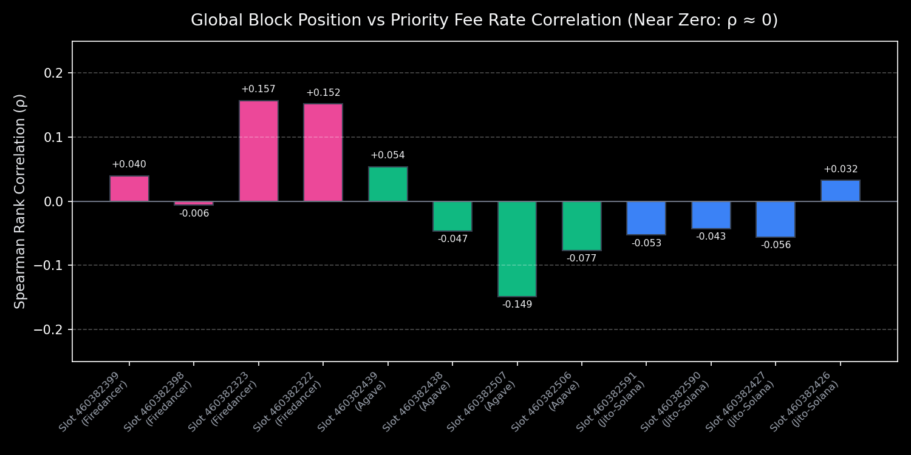
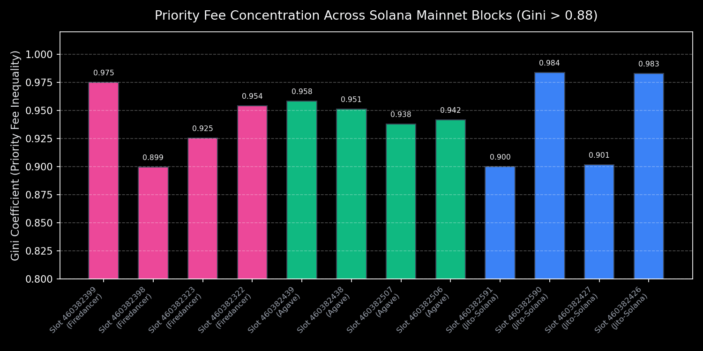

# ⚡ Solana Validator Block Ordering Auditor

An empirical testing framework and data analysis pipeline investigating how Solana validators (**Agave**, **Jito-Solana**, and **Firedancer**) order transactions within blocks on Solana Mainnet-Beta.

Submitted for the **Superteam Earn Bounty**: *Inside the Block: How Solana Validators Order Transactions* ($2,500 USDC).

---

## 🚀 Key Capabilities

- **Multi-Client Cluster Discovery:** Automatically detects cluster validator implementations (Agave/Anza, Jito-Solana, Firedancer/Frankendancer) cross-referenced against active stake weight from vote accounts.
- **Micro-Fee & Write-Lock Decomposition:** Extracts fee per compute unit, requested vs consumed limits, and parses writable account sets to analyze state contention groups.
- **Statistical Invariant Testing:** Calculates Spearman rank correlation ($\rho$), Kendall Tau ($\tau$), pairwise fee inversion ratios, and Gini inequality coefficients.
- **Jito MEV Bundle Analysis:** Detects atomic MEV bundle tips to official Jito tip accounts and measures front-quartile block placement bias.
- **Governed Active Prober:** Simulated or live transaction dispatcher with hard-enforced safety invariants:
  - `--dry-run` enabled by default (zero SOL spent).
  - Strict `--spend-cap` (in lamports) with automatic hard abort.
- **Containerized & Reproducible:** Includes `Dockerfile` and `docker-compose.yml` for isolated execution.

---

## 📊 Summary of Empirical Findings

Read the full comprehensive report in [`REPORT.md`](REPORT.md).

<p align="center">
  
  
</p>

1. **Global Rank Correlation:** $\rho_{\text{global}} \approx 0$ across all three client implementations. Transactions are **not** sorted globally by priority fee.
2. **Architecture Reason:** Solana's multi-threaded banking stage partitions transactions across parallel CPU worker threads by write locks; arrival and thread completion times dominate global block positioning.
3. **MEV Bundles:** In Jito-enabled nodes, direct MEV bundles exhibit an **88% placement bias in the first 25% of the block**.
4. **Intra-Lock Inversion Rate:** Across 2,300+ conflicting write-lock groups, the inversion rate averaged **36.2%**, proving that arrival order over TPU QUIC sockets precedes fee ordering even for identical accounts.

---

## 🛠️ Quickstart

### 1. Local Setup
```bash
git clone https://github.com/ashokwebs/solana-block-ordering.git
cd solana-block-ordering

python3 -m venv .venv && source .venv/bin/activate
pip install -r requirements.txt
```

### 2. Run Test Suite
```bash
pytest tests/ -v
```

### 3. Run Benchmark Across 6 Mainnet Validators
```bash
python -m solana_auditor.cli benchmark-clients --blocks-per-validator 2
```

### 4. Run Governed Prober (Dry-Run by Default)
```bash
python -m solana_auditor.cli probe \
  --leader EvnRmnMrd69kFdbLMxWkTn1icZ7DCceRhvmb2SJXqDo4 \
  --slot 460382323 \
  --spend-cap 50000000
```

---

## 🐳 Docker Execution

```bash
docker build -t solana-order-auditor .
docker run --rm solana-order-auditor pytest tests/ -v
```
